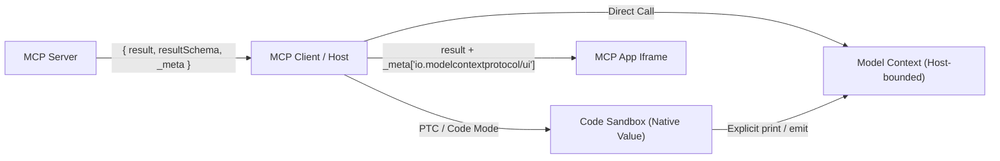

# Proposal: Unified Typed Tool Results

**Contributors:** @kurtisvg  
**Status:** 💬 Seeking Feedback  
**Last Updated:** Nov 9, 2026

## Summary

To work cleanly in both chat loops and Programmatic Tool Calling (PTC / code mode), MCP tools should return a single value with an explicit schema, separate from rules about what enters model context or what hydrates a UI widget:

1. Require `outputSchema` on every `Tool`, using `{}` when a tool's return shape isn't known ahead of time and `{ "type": "null" }` for side-effect-only tools.
2. Replace `content` and `structuredContent` with required `result` and `resultSchema` on `CallToolResult`, making every tool response self-describing without JSON-in-text duplication.
3. Restrict tool execution errors (`isError: true`) to a plain `string`, routing tool errors back to the model while keeping JSON-RPC `error` responses for protocol and client-level failures.
4. Remove `audience` annotations so the invocation mode and model-authored code control what enters model context within host limits, and move UI-only widget state into `_meta["io.modelcontextprotocol/ui"]`.
5. Keep full JSON Schema 2020-12, paired with PTC Type Mapping guidance and preloaded `urn:mcp:*` schemas for media and resources.

## Proposed Design

### Core Protocol Changes

#### Tool Definition

Every `Tool` **MUST** declare an `outputSchema`. Servers **SHOULD** aim for the most specific schema possible and treat `{}` and `{ "type": "null" }` as last resorts when no concrete return shape applies. Unlike `inputSchema`, which requires `"type": "object"` for named arguments, `outputSchema` can describe any JSON return value:

- Typed tools declare the JSON Schema of their return value (`object`, `array`, primitive, or union).
- Text tools return a plain JSON string (`{ "type": "string" }`).
- Void / side-effect tools like `send_email` declare `{ "type": "null" }` and return `result: null`.
- Dynamic or untyped tools like an ad-hoc SQL runner declare `{}`, meaning any JSON value in JSON Schema 2020-12, making it explicit that the return shape isn't fixed ahead of time.

```typescript
export interface Tool {
  name: string;
  inputSchema: JSONSchemaObject;  // Required; top-level type MUST be "object"
  outputSchema: JSONSchemaObject; // Required; any JSON Schema type (`{}` means Any)
  // ...existing Tool fields (title, description, icons, execution, annotations, _meta)...
}
```

#### Tool Results

`CallToolResult` replaces `content` and `structuredContent` with required `result` and `resultSchema` fields:

```typescript
export interface CallToolResult extends Result {
  result: JSONValue;              // Required return value (object, array, primitive, or null)
  resultSchema: JSONSchemaObject; // Required concrete schema of `result` for this call
  isError?: boolean;              // True if the tool call failed (default: false)
  _meta?: MetaObject;             // Protocol and extension metadata
}
```

Requiring `resultSchema` makes every tool response self-describing at runtime, even when `Tool.outputSchema` is `{}`, when `outputSchema` is a union, or when `ToolResultContent` is replayed in `sampling/createMessage` without a `tools` list.

When `isError` is false or omitted, `Tool.outputSchema` describes all the types a tool can return, and `resultSchema` narrows that down to the schema of the value returned on that call:

1. When `outputSchema` is a union (`anyOf` / `oneOf`), `resultSchema` **SHOULD** narrow down to the single branch returned so callers don't have to guess which variant arrived. To avoid repeating large schemas on the wire, `outputSchema` **MAY** declare a standard JSON Schema `"$id"` that clients register locally on `tools/list`, allowing `resultSchema` to reference it with a standard `$ref`.

   `Tool.outputSchema`:

   ```json
   {
     "$id": "urn:example:run-report-output",
     "$defs": {
       "Rows": { "type": "array", "items": { "type": "object", "properties": { "id": { "type": "integer" } }, "required": ["id"] } },
       "CsvLink": { "$ref": "urn:mcp:resource-link" },
       "Summary": { "type": "string" }
     },
     "anyOf": [
       { "$ref": "#/$defs/Rows" },
       { "$ref": "#/$defs/CsvLink" },
       { "$ref": "#/$defs/Summary" }
     ]
   }
   ```

   `CallToolResult`:

   ```json
   {
     "result": { "type": "resource_link", "uri": "file:///tmp/out.csv", "name": "out.csv" },
     "resultSchema": { "$ref": "urn:example:run-report-output#/$defs/CsvLink" }
   }
   ```

2. When `outputSchema` is `{}`, a dynamic tool **MAY** return a concrete `resultSchema` describing the runtime value, such as the column types of a SQL query, or `{}` if untyped. PTC runtimes **SHOULD** expose an opt-in helper like `call_raw()` so code can inspect `resultSchema` when needed, such as reading SQL column types when `0` rows return.
3. When `outputSchema` has a single return type, `resultSchema` equals `outputSchema`, either inline for small schemas (`{ "type": "string" }`, `{ "type": "null" }`) or `{ "$ref": "<outputSchema.$id>" }` for larger struct schemas. Schemas must not use bare `{ "$ref": "#" }`, which in JSON Schema 2020-12 refers to `resultSchema` itself rather than `Tool.outputSchema`.

Clients do not need a static schema-subtype solver. When `isError` is false or omitted, clients validate `result` against both `Tool.outputSchema` and `CallToolResult.resultSchema`. If a response fails validation, clients treat it as an error rather than passing invalid data to the model or sandbox.

#### Error Handling

MCP separates errors meant for the model from errors meant for the client / harness (SEP-1303), without introducing a custom error schema.

Tool execution errors are routed to the model. Input validation errors, upstream API failures, and business-logic rejections return `CallToolResult` with `isError: true`, `result` set to a `string` error message, and `resultSchema: { "type": "string" }`. Validators **MUST** skip `Tool.outputSchema` when `isError: true`.

- In direct chat calls, the host passes the error string into model context so the model can adjust its parameters and retry.
- Clients using PTC can surface `isError: true` as an exception such as `ToolError(tool_name, message)` rather than returning the error string as normal data. Model-authored code can catch that exception when a failure is expected; if uncaught, execution stops and the host can return the error message, stack trace, and any buffered `stdout` from earlier steps back to the model so it can fix its code.

```json
{
  "jsonrpc": "2.0",
  "id": 4,
  "result": {
    "isError": true,
    "result": "Invalid departure date '2024-12-12': date must be in the future.",
    "resultSchema": { "type": "string" }
  }
}
```

Unknown tools (`-32602`), malformed JSON-RPC envelopes, auth failures, and server crashes use the standard JSON-RPC `error` response (`{ code: number, message: string, data?: unknown }`). Unlike tool call errors, JSON-RPC errors indicate harness or infrastructure problems and are handled by the client according to host policy, such as logging, retrying, or surfacing an execution failure rather than normal tool output.

### Media, Resources, and Multi-Item Results

#### Built-in Offline Schemas

Validators **MUST NOT** make network requests to resolve external `$ref`s (SEP-2106). To represent media and resources in `inputSchema`, `outputSchema`, and `resultSchema` without a special outer envelope, MCP defines five `urn:mcp:*` JSON Schema `$id`s in `schema.json` that every SDK and validator **MUST** preload locally for the negotiated `protocolVersion`:

| Preloaded `$id` | Purpose | Core Fields |
| :--- | :--- | :--- |
| `urn:mcp:image` | Base64 image | `type: "image"`, `mimeType`, `data` |
| `urn:mcp:audio` | Base64 audio | `type: "audio"`, `mimeType`, `data` |
| `urn:mcp:resource-link` | Server `Resource` URI link | `type: "resource_link"`, `uri`, `name` (+ optional `title`, `description`, `mimeType`, `size`, `icons`) |
| `urn:mcp:embedded-resource` | Inline text or blob resource | `type: "resource"`, `resource` (`{ uri, text }` or `{ uri, blob }`, optional `mimeType`) |
| `urn:mcp:content-block` | Legacy multi-block union | `anyOf` of `string` (or legacy `TextContent`) and the 4 schemas above |

##### Plain Text

```json
{
  "result": "22.5°C, Partly cloudy",
  "resultSchema": { "type": "string" }
}
```

##### Image

```json
{
  "result": { "type": "image", "mimeType": "image/png", "data": "iVBORw0KGgo..." },
  "resultSchema": { "$ref": "urn:mcp:image" }
}
```

##### Audio

```json
{
  "result": { "type": "audio", "mimeType": "audio/wav", "data": "UklGRiQAAAB..." },
  "resultSchema": { "$ref": "urn:mcp:audio" }
}
```

##### Resource Link

```json
{
  "result": { "type": "resource_link", "uri": "file:///src/main.rs", "name": "main.rs", "mimeType": "text/x-rust" },
  "resultSchema": { "$ref": "urn:mcp:resource-link" }
}
```

##### Embedded Resource

```json
{
  "result": {
    "type": "resource",
    "resource": { "uri": "file:///src/main.rs", "mimeType": "text/x-rust", "text": "fn main() {}" }
  },
  "resultSchema": { "$ref": "urn:mcp:embedded-resource" }
}
```

- In direct chat calls, hosts walk `resultSchema` alongside `result` to extract any `urn:mcp:image` or `urn:mcp:audio` values at the top level or nested inside objects and arrays as multimodal attachments, replacing raw base64 strings in the JSON text shown to the model.
- In PTC, sandboxes **SHOULD** provide a structured output helper such as `emit(value)` so code can pass images or audio to the model without dumping multi-MB base64 strings via `print()`, and a `read_resource(uri)` helper because `resource_link.uri` refers to the MCP server's resource namespace rather than the local sandbox filesystem.

#### Backward-Compatible Multi-Block Results

In order to preserve backward compatibility with `ContentBlock`, servers may choose to send multiple types in an array. A tool migrating from `ContentBlock[]` can declare an array of `urn:mcp:content-block` items in `outputSchema`, and list each item's schema in `prefixItems` on the response, or `maxItems: 0` when empty:

```json
{
  "result": [
    "Generated Q3 revenue chart and exported raw CSV:",
    { "type": "image", "mimeType": "image/png", "data": "iVBORw0KGgo..." },
    { "type": "resource_link", "uri": "file:///exports/q3.csv", "name": "q3.csv", "mimeType": "text/csv" }
  ],
  "resultSchema": {
    "type": "array",
    "prefixItems": [
      { "type": "string" },
      { "$ref": "urn:mcp:image" },
      { "$ref": "urn:mcp:resource-link" }
    ],
    "minItems": 3,
    "items": false
  }
}
```

Mixed arrays make it easy to migrate existing multi-block tools, though new tools **SHOULD** prefer an object with named fields so callers can read `res["csv"]` instead of `res[2]`.

### Routing and UI Separation

#### Context Routing

This proposal removes `annotations.audience` from tool results. Servers only describe the shape of their data, and the client decides where the result goes based on how the tool was called:

- When the model calls a tool directly in chat, it wants to observe the result. The host puts `result` into model context, applying host policies such as size caps, truncation, or redaction.
- In PTC, the tool wrapper validates `result` and returns it as a normal value inside the sandbox rather than putting it into model context. The generated code chooses what to pass to another tool, write to a file, or surface to the model, subject to host limits.



#### MCP Apps UI Data

Presentation-only data for MCP Apps widgets moves out of `structuredContent` into `_meta["io.modelcontextprotocol/ui"]` (SEP-1865, SEP-2133). Here's an example of how MCP Apps could do what it needs to do after this change, paired with an optional UI `outputSchema` on `Tool`. This is just an example; the exact shape is left up to MCP Apps:

```json
{
  "result": {
    "cartId": "c_89",
    "subtotalUsd": 48.50,
    "items": [{ "sku": "bk_1", "qty": 2 }]
  },
  "resultSchema": { "$ref": "urn:example:cart" },
  "_meta": {
    "io.modelcontextprotocol/ui": {
      "resourceUri": "ui://shop/cart.html",
      "data": { "thumbnails": { "bk_1": "https://..." }, "expandedPanel": "shipping" },
      "resultSchema": { "$ref": "urn:example:cart-ui" }
    }
  }
}
```

To avoid duplicating shared data, `ui/notifications/tool-result` delivers both `result` and `_meta["io.modelcontextprotocol/ui"]`, along with `isError` messages on failure, to the `ui://` iframe. Domain records stay in `result` so both PTC code and the widget can read them, while UI-only state stays in `_meta`.

### PTC Type Mapping

Any valid JSON Schema 2020-12 schema, without external network `$ref`s, is allowed in `outputSchema` and `resultSchema`. Because JSON Schema was built to validate data rather than define static types, keywords like `not` or `if`/`then`/`else` don't translate cleanly to return types in Python or TypeScript. Servers **SHOULD** stick to the standard shapes that libraries like Pydantic, Zod, TypeBox, and Go `jsonschema` already emit:

| Shape | JSON Schema 2020-12 | Python PTC Stub | TypeScript PTC Stub |
| :--- | :--- | :--- | :--- |
| Any | `{}` | `Any` | `any` |
| Primitive / Nullable | `"type": "string" \| "number" \| "integer" \| "boolean" \| "null"` or `["<prim>", "null"]` | `str`, `float`, `int`, `bool`, `None` (`T \| None`) | `string`, `number`, `boolean`, `null` (`T \| null`) |
| Literal / Enum | `{ "const": ... }` or `{ "enum": [...] }` | `Literal[...]` | `"a" \| "b" \| 1` |
| Object (Struct) | `{ "type": "object", "properties": {...}, "required"?: [...] }` | `TypedDict` | `interface { ... }` |
| Map (Dict) | `{ "type": "object", "additionalProperties": <Schema> }` or `{ "type": "object" }` | `dict[str, V]` | `Record<string, V>` |
| List / Tuple | `{ "type": "array", "items": <S> }` or `"prefixItems": [...]` | `list[T]` / `tuple[...]` | `T[]` / `[T1, T2]` |
| Union | `{ "anyOf": [...] }` / `{ "oneOf": [...] }` | `A \| B` | `A \| B` |
| Reference | `{ "$ref": "#/$defs/Name" \| "<$id>" \| "urn:mcp:*" }` | `Name` / `McpImage` | `Name` / `McpImage` |

In Python, PTC runtimes can use plain dicts typed with `TypedDict` so `res["field"]` and `json.dumps(res)` work without extra conversion.

Validation and documentation keywords like `format`, `minimum`, `pattern`, and `description` still work as usual: clients enforce them at runtime, and stub generators can include them in docstrings.

When a schema uses non-structural keywords like `not`, `if`/`then`/`else`, `patternProperties`, or `$dynamicRef`, clients **MUST** still validate the full schema at runtime and can fall back to `Any` or `unknown` for that subschema in generated stubs.

## Examples

### Static Tools

When a tool has a fixed return type, clients can generate typed stubs from `outputSchema` before any code runs:

```python
# Generated Python stubs from Tool.outputSchema:
class User(TypedDict):
    name: str
    email: str

def list_unwelcomed_users() -> list[User]: ...
def send_email(*, to: str, subject: str, body: str) -> None: ...

# Model-authored PTC script:
users = list_unwelcomed_users()
for user in users:
    send_email(to=user["email"], subject="Welcome!", body="Hi " + user["name"])
print(f"Sent {len(users)} welcome emails")
```

### Dynamic Tools

For a generic SQL tool like `query(sql)`, the output columns depend on the query, so `Tool.outputSchema` is `{}` and `CallToolResult` provides the row schema discovered at runtime.

Tool definition (`tools/list`):

```json
{
  "name": "query",
  "description": "Execute a read-only SQL query",
  "inputSchema": {
    "type": "object",
    "properties": { "sql": { "type": "string" } },
    "required": ["sql"]
  },
  "outputSchema": {}
}
```

Tool result (`tools/call`):

```json
{
  "jsonrpc": "2.0",
  "id": 2,
  "result": {
    "result": [
      { "name": "Ada Lovelace", "email": "ada@example.com" },
      { "name": "Grace Hopper", "email": "grace@example.com" }
    ],
    "resultSchema": {
      "type": "array",
      "items": {
        "type": "object",
        "properties": { "name": { "type": "string" }, "email": { "type": "string" } },
        "required": ["name", "email"]
      }
    }
  }
}
```

In PTC, `query(...)` returns the list of row dicts directly to the script, and only the printed summary enters model context.

## Alternatives Considered

### Patching `content` and `structuredContent` Instead of Replacing Them

Proposals like making `content` optional (PR #2847), clarifying model visibility (SEP-2200), and allowing non-object `structuredContent` (SEP-2106) avoid breaking the wire format, but still leave two result fields on every response. Servers still have to guess which field a client reads, and shipping a prose summary alongside structured JSON risks dropping IDs or fields that a chat model needs on its next turn. Replacing both fields with `result` and `resultSchema` gives every tool a single return value, like a normal function call.

### Extending `audience` Annotations or Negotiating Result Variants

Adding a `"programmatic"` target to `annotations.audience` or negotiating result variants per call (SEP-3279) requires the server to predict how its output will be used. In PTC, the same return value might be fed into another tool, saved to a file, or summarized for the model depending on the task. Keeping `result` focused on the data itself lets a single tool definition work in both chat and code mode.

### Identifying Built-in Media and Resource Schemas

Several options exist for representing MCP's built-in media and resource types (`image`, `audio`, `resource_link`, `embedded_resource`) inside `outputSchema` and `resultSchema` without making network requests:

| Option | Example | Pros | Cons |
| :--- | :--- | :--- | :--- |
| Preloaded `urn:mcp:*` URNs | `{ "$ref": "urn:mcp:image" }` | Short and clearly offline. JSON Schema 2020-12 recommends `urn:` `$id`s for non-network schemas, so validators never try to fetch them over HTTP. | Top-level `urn:mcp:*` namespaces normally expect IANA registration (RFC 8141), and cross-references must use full URNs instead of relative paths. |
| Preloaded `https://modelcontextprotocol.io/...` `$id`s | `{ "$ref": "https://modelcontextprotocol.io/schemas/image" }` | Uses a domain MCP already owns and matches how JSON Schema names its own meta-schema. | Looks like a live URL, adds noise on the wire, and can trigger accidental network fetches in misconfigured validators. |
| Custom URI scheme (`mcp://`) | `{ "$ref": "mcp://schemas/image" }` | Clearly offline and supports relative paths. | Custom schemes carry RFC 7595 registration overhead and look like MCP `Resource` URIs (`ui://`, `file://`). |
| Inlining full object schemas (no `$ref`) | `{ "type": "object", "properties": { "type": { "const": "image" }, ... } }` | Needs no preloaded schema registry. | Repeats verbose schemas on every call and forces clients to duck-type objects to detect images or links. |
| JSON Schema `contentEncoding` / custom keywords | `{ "type": "string", "contentEncoding": "base64", "contentMediaType": "image/png" }` or `"x-mcp-type"` | Avoids `$ref` URIs for simple binary strings. | Can't express dynamic MIME types (`image/*`) or `resource_link` metadata, and custom keywords need validator plugins. |

### Replacing JSON Schema 2020-12 with Another Schema Standard

| Standard | Strengths | Trade-offs for MCP & PTC |
| :--- | :--- | :--- |
| JSON Schema 2020-12 | Already used for `inputSchema`, OpenAPI 3.1, LLM APIs, and major SDK libraries. Supports primitives, arrays, objects, unions, and `{}`. | Validation keywords like `not` and `if`/`then`/`else` don't map cleanly to static types. |
| JSON Type Definition (RFC 8927) | Eight simple forms built specifically for 1:1 code generation, where `{}` means `Any`. | Can't express primitive or array unions like `string \| User[]`, lacks basic validation rules, and isn't supported by LLM APIs. |
| TypeSpec / OpenAPI | Clean authoring syntax with good union support. | An authoring IDL that compiles down to JSON Schema rather than a standalone wire format. |
| Protobuf / CDDL (RFC 8610) | Strict types and mature versioning rules. | Awkward fit for dynamic JSON shapes like ad-hoc SQL queries and untyped `{}` values, and requires non-JSON tooling. |

Switching formats would also force MCP tools to use one schema language for `inputSchema` and another for `outputSchema`.
